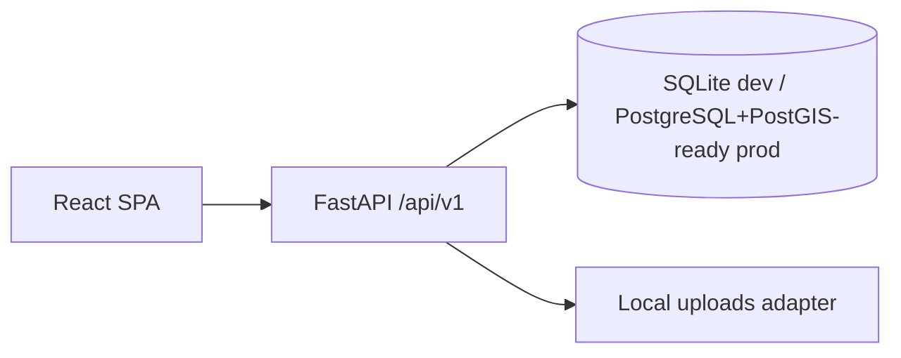

# Architecture

Service boundaries: routes in `app/main.py`, calculation in `app/calc.py`, auth in `app/security.py`, models in `app/models.py`. Geometry stored as GeoJSON JSON + lat/lon for SQLite portability; production can migrate boundary to PostGIS geometry (documented limitation).
